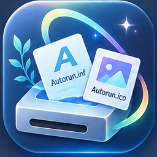

# Kiseki Autorun Vault | キセキのオートラン書庫



> WindowsドライブのAutorunアイコンと設定ファイルを、見やすく・安全に収集するRust製アーカイブツール。

**Kiseki Autorun Vault** は、Windows 11でドライブ文字が割り当てられたボリュームを調べ、ルート直下の `Autorun.ico` / `Autorun.inf` をプレビュー・一括保存するデスクトップアプリです。日本語名：**キセキのオートラン書庫**。

   

## 主な機能

**v1.2.0の画面構成**：ウィンドウ上部にドライブのカード一覧、下部に選択ドライブの詳細情報プレビューを配置しました。上下エリアの境界をドラッグして高さを調整できます。

- ドライブ文字、ボリューム名、ファイルシステム、総容量と空き容量を一覧表示
- 各ドライブ直下の `Autorun.ico` と `Autorun.inf` を検出
- PNG内蔵ICO（16bit/channelを8bit表示用に変換）およびBMP型ICOのプレビュー
- INFテキストの表示と、Hidden / Read-only / System属性の確認
- ドライブ検索・検出済みドライブへの絞り込み・対象の選択（上段カード形式、最大6列）
- 下段に選択ドライブのICO、ボリューム名、容量、ファイル属性、INF内容を表示（INFコピー対応）
- 実行ファイルの隣に `Autorun_Collection` を作成してまとめて収集
- 既存ファイルへの上書き確認（上書き／スキップ／キャンセル）
- コピー結果を `Export_Report.txt` に記録

## 動作環境とビルド

- Windows 11（64bit推奨）
- Rust stable / Cargo（edition 2021）
- MSVC C++ Build Tools + **Windows SDK（rc.exe）**（Windows MSVCターゲットの場合）。アプリのアイコンをEXEに埋め込むため必要です。

```powershell
cargo build --release
```

または `build_release.bat` を実行してください。

生成物：`target\release\kiseki_autorun_vault.exe`

`build.rs` は `assets/app.ico` をEXEのリソースに埋め込みます。ウィンドウおよびタスクバーにも `assets/app_256.png` のアイコンを設定しています。追加素材をユーザーが配置する必要はありません。

> **ビルド検証状況**：ソース・画像・ZIPの静的整合性を確認していますが、この環境にはWindowsおよびRustコンパイラがなく、Windows実機でのコンパイル・起動検証は未実施です。新規追加の `winres` に必要なWindows SDKがない場合は `build.rs` のリソースコンパイルで失敗します。

## 使い方

1. アプリを起動し、**上段のパーティションカード**でドライブ一覧を確認します。
2. カード内の**ドライブ名**をクリックすると、**下段の詳細領域**にICOプレビュー、INF内容、容量およびファイル属性が表示されます。
3. 保存したいドライブをチェックして一括エクスポートします。
4. 既存ファイルがある場合、上書き・スキップ・キャンセルを選択します。
5. 出力先の `Autorun_Collection/Export_Report.txt` で結果を確認します。

## アプリアイコンと素材

| ファイル | 用途 |
|---|---|
| `assets/app.ico` | Windows EXE用の複数サイズ（16〜256px）ICO |
| `assets/app_256.png` | ウィンドウ・タスクバーとREADME用 |
| `assets/app_512.png` | GitHub/紹介画像向け高解像度素材 |

モチーフはドライブ本体・2枚のAutorunファイル・光の軌跡で、Kisekiシリーズを意識した青系のデザインです。アイコンは本プロジェクト向けに新規生成したオリジナルデザインをベースにしています。

## 保存形式

```text
kiseki_autorun_vault.exe
Autorun_Collection/
├── C_システム/
│   ├── Autorun.ico
│   └── Autorun.inf
├── D_アプリ/
│   ├── Autorun.ico
│   └── Autorun.inf
└── Export_Report.txt
```

フォルダ名は `ドライブ文字_ボリューム名` 形式です。ファイルがない場合は作成せず、元のドライブにあるファイルを変更しません。

## 注意事項

- **ドライブ文字がないEFI・回復パーティション**は収集しません。
- Hidden / Read-only属性そのものは通常のファイル読み取りを妨げません。ただしACL・ドライブ状態・セキュリティソフトによってはアクセスできない場合があります。
- 保存先への書き込み権限が必要です。実行ファイルはユーザーの書き込み可能な場所へ配置してください。
- 上書きでは一時ファイル作成後、既存ファイルを退避して置換します。ロックや権限により失敗する可能性があります。
- ICOのプレビューに失敗しても、元データのコピーは別処理で行います。
- WindowsのAutoRun動作自体を有効化・変更するアプリではありません。
- コミットや配布物に **自身のドライブから収集した `Autorun_Collection/` を含めないでください**。ドライブ名やINF内容が個人情報・固有情報を含む場合があります。

## 技術スタック

Rust 2021 / `eframe` (egui) 0.32.3 / `image` 0.25 / `png` 0.17 / `windows-sys` 0.59 / `winres` 0.1.12（Windowsビルド時）。依存関係の詳細は `Cargo.toml` を参照してください。

## バージョン履歴

変更履歴は [CHANGELOG.md](CHANGELOG.md) にまとめています。ビルドの警告 `float_literal_f32_fallback` は、該当する数値リテラルを `1.0_f32` と明示して解消を図りました（コンパイル未検証）。

## ライセンス

© 2026 光と影のソネット (Chiaroscuro Sonnet)。このリポジトリ内の独自制作物は [Creative Commons Attribution-ShareAlike 4.0 International (CC BY-SA 4.0)](https://creativecommons.org/licenses/by-sa/4.0/) の下で公開します。全文は [LICENSE](LICENSE) を参照してください。第三者ライブラリには各々のライセンスが適用されます。

**注**：Creative CommonsはCCライセンスをソフトウェアコードに使うことを推奨していません。ソースコード再利用との相性や特許条件等を重視する場合は、将来GPLv3等のソフトウェア向けライセンスへの移行を検討してください。
